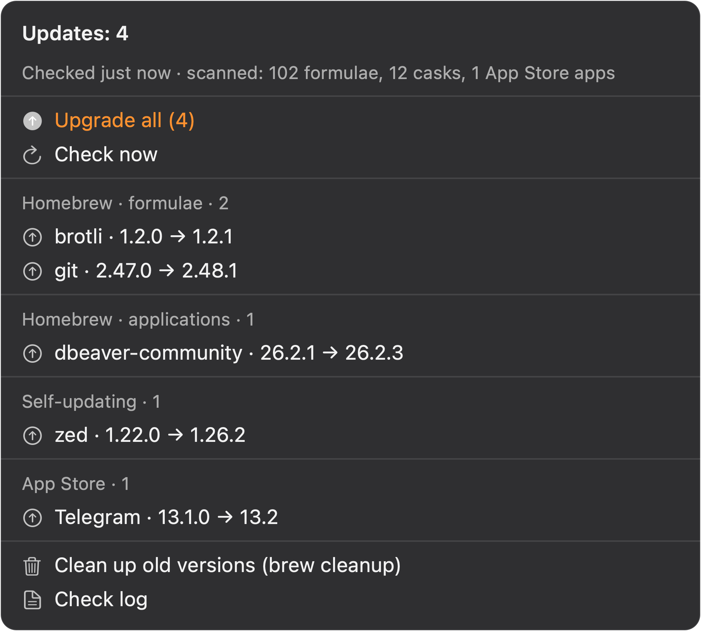

# App Updates for SwiftBar

[](https://github.com/Timebirdss/swiftbar-app-updates/actions/workflows/ci.yml)
[](LICENSE)

**Homebrew + Mac App Store updates, right in your macOS menu bar.**



<sub>macOS dark mode, example data.</sub>

A menu bar icon shows *how many* packages can be upgraded. One click shows *which* ones and their exact
versions, and upgrades them — one package, one category, or everything at once.

```
 ▲ 3
 ────────────────────────────────────────────
 **Updates: 3**
 Checked 4 min ago · scanned: 103 formulae, 12 casks, 1 App Store apps
 ────────────────────────────────────────────
 Upgrade all (3)                        ⬆
 Check now                              ↻
 ────────────────────────────────────────────
 Homebrew · formulae · 2
 brotli · 1.2.0 → 1.2.1
 git · 2.47.0 → 2.48.1
 ────────────────────────────────────────────
 Homebrew · applications · 1
 dbeaver-community · 26.2.1 → 26.2.3
 ────────────────────────────────────────────
 Self-updating · 2
 zed · 1.22.0 → 1.26.2
 google-chrome · 154.0.1 → 156.0.2
 ────────────────────────────────────────────
 App Store · 1
 Telegram · 13.1.0 → 13.2
 ────────────────────────────────────────────
 Clean up old versions (brew cleanup)
 Check log
```

## Why another updater plugin

- **The menu opens instantly.** All the network work (`brew update`, `brew outdated`, `mas outdated`)
  happens in the background; the menu itself only renders a local cache. No spinner, no waiting.
- **It knows which apps update themselves.** Zed, Chrome, DBeaver, Maccy and friends ship with
  `auto_updates: true`. They are listed separately and are **not** counted in the badge and **not**
  touched by “Upgrade all” — reinstalling a self-updating app over itself is asking for trouble.
- **One click per package, not per category.** Every row upgrades exactly that package and shows the
  command it will run.
- **“Skip this version” is one Option-click away.** Some updates break things; you should be able to
  say “not this one” without muting the package forever.
- **Nothing hangs.** Every upgrade runs with a timeout (30 min for formulae that build from source,
  10 min for apps), because Homebrew’s `curl` has none and a stalled mirror can wait forever.
- **No stray Terminal windows.** Upgrades that need a TTY are launched through a `.command` file, so
  they work even when Terminal has no open windows (SwiftBar’s built-in “run in Terminal” does not).

## Requirements

| | |
|---|---|
| macOS | 11+ |
| [SwiftBar](https://github.com/swiftbar/SwiftBar) | any recent release |
| [Homebrew](https://brew.sh) | for brew-side updates |
| `jq` | `brew install jq` |
| [`mas`](https://github.com/mas-cli/mas) | optional, only for App Store updates |

## Install

With Homebrew (recommended):

```bash
brew tap Timebirdss/tap
brew trust timebirdss/tap        # Homebrew 7+ asks this for third-party taps
brew install --cask app-updates
```

Or from source:

```bash
git clone https://github.com/Timebirdss/swiftbar-app-updates.git
cd swiftbar-app-updates
./install.sh
```

The script copies the helper to `~/.local/bin/app-updates`, the plugin to your SwiftBar plugin folder,
creates a config, runs the first check and asks SwiftBar to reload.

Uninstall with `brew uninstall --cask app-updates`, or `./uninstall.sh` for a source install
(add `--purge` to delete the config too).

## Usage

| Where | What it does |
|---|---|
| Menu bar icon | number of real updates; grey when everything is up to date |
| **Upgrade all** | formulae, then apps, then App Store — one by one, failures do not stop the rest |
| **Check now** | force a check without waiting for the 6-hour schedule |
| row click | upgrade that single package |
| **⌥ + row click** | skip that version permanently |
| **Clean up old versions** | `brew cleanup --prune=all`, reports how much was freed |
| **Check log** | opens the refresh log |

## Configuration

`~/.config/app-updates/config` — plain bash, sourced on every run:

```bash
# Proxy for brew and mas. brew ignores the system SOCKS proxy, so point it here
# when your VPN is the only way out.
PROXY=""

# Packages that are never offered.
IGNORE=""

# Versions to skip: "name=version". "name=" skips the package forever.
SKIP=""

# How often to check, in seconds (default 6 hours).
TTL=21600
```

The same values can be overridden with environment variables
`APP_UPDATES_CACHE`, `APP_UPDATES_CONFIG`, `APP_UPDATES_STATE` (useful for tests).

## How it works

```
SwiftBar (every 5 min)          background                      cache
──────────────────────          ─────────────────               ─────────────
app-updates menu  ──────────▶   checks the cache age
   │                            └─ older than TTL? ──▶ app-updates refresh
   │                                                        ├─ brew update      (≤ every 6 h)
   └── renders state.json                                   ├─ brew outdated --json
                                                            ├─ mas outdated --json
                                                            ├─ mark self-updating casks
                                                            └─ apply IGNORE / SKIP
```

The helper is a single bash script with no runtime dependencies beyond `jq`, `brew` and `mas`.
Refresh writes a normalized `state.json`; the menu is one `jq` pass over it.

## Troubleshooting

**The icon is grey, but I just installed something.** Checks run every 6 hours. Hit *Check now*, or
lower `TTL` in the config.

**The badge number never matches `brew outdated`.** It should: formulae + non-self-updating casks +
App Store apps. Self-updating casks are excluded on purpose (see above), and they are visible in their
own section.

**An upgrade hangs.** Some casks pull from third-party mirrors that stall. The plugin aborts after the
timeout and tells you which package it was; the reason ends up in `~/Library/Caches/app-updates/refresh.log`.
If the mirror is only reachable through a proxy, set `PROXY` in the config.

**No App Store updates at all.** `mas` returns nothing when you are not signed in to the App Store —
open the App Store app once and sign in.

**A menu item does nothing and the Mac beeps.** That used to be SwiftBar’s “run in Terminal” failing
with AppleScript error `-1728` when Terminal had no windows. This plugin avoids that path entirely by
launching a `.command` file instead; if you still see it, please open an issue with the output of
`log show --last 5m --predicate 'subsystem == "com.ameba.SwiftBar"'`.

## Development

```bash
./tests/run.sh          # smoke tests, fixtures only, no Homebrew needed
shellcheck bin/app-updates plugin/app-updates.5m.sh install.sh uninstall.sh
```

Pull requests are welcome; keep the menu render path allocation-free (one `jq` call) and add a fixture
for anything that parses external output.

## License

MIT — see [LICENSE](LICENSE).
